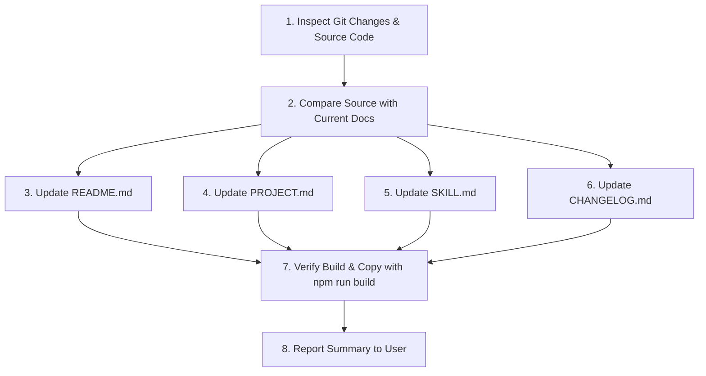

This file is a merged representation of the entire codebase, combined into a single document by Repomix.

# File Summary

## Purpose
This file contains a packed representation of the entire repository's contents.
It is designed to be easily consumable by AI systems for analysis, code review,
or other automated processes.

## File Format
The content is organized as follows:
1. This summary section
2. Repository information
3. Directory structure
4. Repository files (if enabled)
5. Multiple file entries, each consisting of:
  a. A header with the file path (## File: path/to/file)
  b. The full contents of the file in a code block

## Usage Guidelines
- This file should be treated as read-only. Any changes should be made to the
  original repository files, not this packed version.
- When processing this file, use the file path to distinguish
  between different files in the repository.
- Be aware that this file may contain sensitive information. Handle it with
  the same level of security as you would the original repository.

## Notes
- Some files may have been excluded based on .gitignore rules and Repomix's configuration
- Binary files are not included in this packed representation. Please refer to the Repository Structure section for a complete list of file paths, including binary files
- Files matching patterns in .gitignore are excluded
- Files matching default ignore patterns are excluded
- Files are sorted by Git change count (files with more changes are at the bottom)

# Directory Structure
````
.agents/
  skills/
    update-documentation/
      SKILL.md
.codegraph/
  .gitignore
skills/
  jsweb-ui/
    SKILL.md
src/
  evaluator.ts
  index.ts
  parser.ts
  reactivity.ts
.gitignore
.prettierignore
.prettierrc
CHANGELOG.md
index.html
LICENSE
package.json
PROJECT.md
publish.js
README.md
tsconfig.json
vite.config.ts
````

# Files

## File: .codegraph/.gitignore
````
# CodeGraph data files — local to each machine, not for committing.
# Ignore everything in .codegraph/ except this file itself, so transient
# files (the database, daemon.pid, sockets, logs) never show up in git.
*
!.gitignore
````

## File: skills/jsweb-ui/SKILL.md
````markdown
---
name: jsweb-ui
description: Comprehensive guide and operational instructions for building reactive user interfaces with the @jsweb/ui micro-framework. Use this skill whenever creating, modifying, or refactoring web applications that use @jsweb/ui, or when building fine-grained reactive HTML components with custom directives (ui:*, :*, ui@*, @*), two-way data binding, conditional rendering, keyed list loops, DOM refs, and shared reactive stores without a Virtual DOM.
---

# @jsweb/ui Skill Guide

`@jsweb/ui` is a lightweight, zero-dependency frontend micro-framework written in TypeScript. It delivers Vue 3-inspired fine-grained reactivity (`Proxy` + `ReactiveEffect`) combined with Alpine.js-style declarative HTML attributes, applying updates directly to the real DOM without any Virtual DOM overhead.

---

## 1. Quick Start & Installation

### NPM / Bundler (Vite, Webpack, Rollup)

```bash
npm install @jsweb/ui
```

```typescript
import { createScope, reactive, watch } from '@jsweb/ui'

const state = reactive({
  count: 0,
  increment() {
    this.count++
  },
})

createScope('#app', state)
```

### Standalone CDN (Direct HTML / No Build Step)

Available via unpkg or jsDelivr. Exposes the global object `window.jsweb.ui`:

```html
<!doctype html>
<html lang="en">
  <head>
    <meta charset="UTF-8" />
    <script src="https://unpkg.com/@jsweb/ui"></script>
  </head>
  <body>
    <div :scope="{ count: 0 }">
      <h1 :text="count"></h1>
      <button @click="count++">+</button>
    </div>

    <script>
      const { createScope } = window.jsweb.ui
      createScope('body')
    </script>
  </body>
</html>
```

---

## 2. Core Architecture & Mental Model

1. **No Virtual DOM**: Changes to reactive properties mutate the real DOM directly using targeted granular effects.
2. **Deep Proxy Reactivity**: State created with `reactive()` wraps objects and arrays into reactive Proxies. Mutating nested properties or calling array methods (`push`, `pop`, `splice`, `shift`, etc.) triggers targeted DOM re-renders.
3. **Template Directives Cleanup**: Directive attributes (`:text`, `:bind`, `:if`, `:for`, `:class`, etc.) are evaluated and immediately removed from DOM elements after mounting, keeping the HTML clean.
4. **Context Hierarchy**: Scopes inherit variables from outer scopes or parent contexts. Expressions are safely evaluated in the context scope with dynamic evaluation (`with(this)`).
5. **Memory Safe & Auto-Cleanup**: When elements are removed (via `:if` or `:for`), all associated event listeners and reactive effects are automatically cleaned up.

---

## 3. JavaScript / TypeScript API Reference

### `reactive(target)`

Creates a deep reactive Proxy of the given object or array.

- **Object Literal Typing (`ThisType`)**: Wrapped in `ThisType<T & ScopeContext>`, enabling complete IDE autocompletion and strict type checking for `this.property`, `this.method()`, computeds via getters, and framework helpers (`this.$refs`, `this.$emit`).
- **Class Instances**: Fully supports TypeScript class instances (including those extending `Scope`).
- **Deep tracking**: Accessing nested objects returns nested reactive proxies automatically.
- **Array mutations**: Tracks index sets and automatically triggers updates for array length changes.
- **Computed properties**: Use native JavaScript getters (`get prop() { return ... }`). When accessed inside templates or effects, dependencies are automatically tracked.
- **Bypassed types**: `Map`, `Set`, `WeakMap`, `WeakSet`, `Date`, `RegExp`, and DOM `Node` instances are preserved as-is without proxy wrapping.

```typescript
import { reactive } from '@jsweb/ui'

const store = reactive({
  items: ['Learn @jsweb/ui', 'Build an app'],
  filter: '',
  // Native getter acts as a computed property:
  get filteredItems() {
    return this.items.filter((item) =>
      item.toLowerCase().includes(this.filter.toLowerCase()),
    )
  },
  addItem(text: string) {
    if (text.trim()) {
      this.items.push(text.trim())
      this.$emit('item-added', text.trim())
    }
  },
})
```

---

### `Scope` Class & `ScopeContext` Interface

For Object-Oriented component architecture, extend the base `Scope` class. `$refs` is implemented as a read-only `Map` and `$emit` has a standard implementation as `protected`, allowing subclasses to override it:

```typescript
export interface ScopeContext {
  /** Read-only Map indexing referenced DOM nodes */
  readonly $refs: Map<string, any>
  /** Dispatches CustomEvents */
  $emit: (event: string, detail?: any) => void
  /** Root DOM element attached to the scope (read-only) */
  readonly $el: HTMLElement
  /** Current loop index */
  $index?: number
  /** Unique key for loop iteration */
  $key?: any
}

export class Scope {
  readonly $el: HTMLElement
  protected readonly $refs: Map<string, any>
  protected $emit(event: string, detail?: any): void
  declare $index?: number
  declare $key?: any
  constructor(init?: Record<string, any>)
}
```

#### OOP Example:

```typescript
import { createScope, reactive, Scope } from '@jsweb/ui'

class TodoListScope extends Scope {
  tasks: string[] = []
  newTask = ''

  get count() {
    return this.tasks.length
  }

  addTask() {
    if (this.newTask.trim()) {
      this.tasks.push(this.newTask.trim())
      this.newTask = ''
      this.$emit('tasks-updated', this.tasks)
      this.$refs.get('taskInput')?.focus()
    }
  }

  // Can override $emit if custom logic is needed:
  protected override $emit(event: string, detail?: any) {
    console.log(`[Event: ${event}]`, detail)
    super.$emit(event, detail)
  }
}

const todoScope = reactive(new TodoListScope())
createScope('#todo-app', todoScope)
```

---

### `watch<T>(source, callback, options?)`

Watches a reactive property or getter function and fires a callback when its value changes.

- `source`: A getter function `() => value` or a reactive object/array directly (auto-traversed).
- `callback`: `(newValue: T, oldValue: T | undefined) => void`.
- `options`: `{ immediate?: boolean }`. If `immediate: true`, the callback runs immediately on registration (`oldValue` will be `undefined`).
- **Returns**: A `stop()` function to cancel the watcher.

```typescript
import { reactive, watch } from '@jsweb/ui'

const state = reactive({ count: 0 })

const unwatch = watch(
  () => state.count,
  (newVal, oldVal) => {
    console.log(`Count changed from ${oldVal} to ${newVal}`)
  },
  { immediate: true },
)

// When done:
// unwatch()
```

---

### `createScope<T>(selectorOrElement, context?)`

Mounts the reactive engine on a DOM element and parses directives within that tree.

- `selectorOrElement`: A CSS selector string (e.g. `'#app'`, `'body'`) or an `HTMLElement`.
- `context`: An optional initial state object or shared context, typed contextually with `ThisType<T & ScopeContext>`.
- **Automatic Injections**:
  - `context.$emit`: Dispatches bubbling, composed `CustomEvent`s.
  - `context.$refs`: Native `Map<string, any>` storing DOM element references.

```typescript
import { createScope, reactive } from '@jsweb/ui'

const appState = reactive({
  title: 'My Application',
  user: { name: 'Alice' },
})

createScope('#app', appState)
```

---

## 4. Template Directives & Attributes

All directives support both the full syntax (`ui:*`, `ui@*`) and the concise shorthand (`:*`, `@*`). The shorthand is recommended for concise templates.

| Directive    | Shorthand  | Purpose                                                | Example                                    |
| :----------- | :--------- | :----------------------------------------------------- | :----------------------------------------- |
| `ui:scope`   | `:scope`   | Defines local state scope for element and descendants  | `<div :scope="{ open: false }">`           |
| `ui:text`    | `:text`    | Sets reactive `textContent`                            | `<span :text="username"></span>`           |
| `ui:bind`    | `:bind`    | Two-way data binding for form inputs                   | `<input type="text" :bind="query" />`      |
| `ui:if`      | `:if`      | Conditionally mounts/unmounts element in DOM           | `<div :if="isLoggedIn">Welcome</div>`      |
| `ui:for`     | `:for`     | Repeats element over an array (`in` or `of`)           | `<li :for="item of items">`                |
| `ui:key`     | `:key`     | Reconciliation key for list recycling                  | `<li :for="user of users" :key="user.id">` |
| `ui:class`   | `:class`   | Reactive CSS classes (Object, Array, or String)        | `<div :class="{ active: isActive }">`      |
| `ui:style`   | `:style`   | Reactive inline styles (Object key-value)              | `<div :style="{ color: themeColor }">`     |
| `ui:ref`     | `:ref`     | Registers DOM element into `$refs` `Map`               | `<input :ref="searchField" />`             |
| `ui:[attr]`  | `:[attr]`  | Dynamic attribute binding (`:disabled`, `:href`, etc.) | `<button :disabled="isSubmitting">`        |
| `ui@[event]` | `@[event]` | Event listener with modifier support                   | `<button @click.prevent="submit">`         |

---

### Detailed Directive Specifications

#### 1. `:scope`

Sets up a local reactive scope. If an object is supplied, it is merged into the context hierarchy.

```html
<div :scope="{ count: 0, title: 'Counter' }">
  <h2 :text="title"></h2>
  <button @click="count++">Increment</button>
  <span :text="count"></span>
</div>
```

#### 2. `:text`

Updates `textContent`. If the evaluated value is `null` or `undefined`, sets empty text `""`.

```html
<p>Total: <strong :text="totalPrice"></strong></p>
```

#### 3. `:bind` (Two-Way Data Binding)

Automatically handles different input types:

- **Text / Number / Search / Textarea**: Binds `value` property, updates state on the `'input'` event.
- **Checkbox (`type="checkbox"`)**: Binds boolean `checked` property, updates state on `'change'`.
- **Radio (`type="radio"`)**: Sets `checked = (el.value === String(stateValue))`, updates state on `'change'`.
- **Select (`<select>`)**: Binds `value` property, updates state on `'change'`.

```html
<!-- Text / Textarea -->
<input type="text" :bind="user.name" />
<textarea :bind="user.bio"></textarea>

<!-- Checkbox (boolean) -->
<input type="checkbox" :bind="user.agreeToTerms" />

<!-- Radios -->
<input type="radio" name="plan" value="free" :bind="selectedPlan" /> Free
<input type="radio" name="plan" value="pro" :bind="selectedPlan" /> Pro

<!-- Select -->
<select :bind="selectedCountry">
  <option value="BR">Brazil</option>
  <option value="US">USA</option>
</select>
```

#### 4. `:if`

Performs true conditional rendering. When false, the element is detached from the DOM and replaced by a lightweight comment node placeholder. When true, it is inserted back.

```html
<div :if="errorMessage" class="alert alert-danger">
  <span :text="errorMessage"></span>
</div>
```

#### 5. `:for` and `:key`

Iterates over an array using `item of items` or `item in items`.

- **Always provide `:key`** for optimal performance and reliable reconciliation.
- Exposes `$index` (0-based numeric index) and `$key` in the loop's context.
- Recycles existing DOM nodes based on key matches, preserving focus, scroll, and component state.

```html
<ul>
  <li :for="task of tasks" :key="task.id">
    <span :text="$index + 1"></span>.
    <span :text="task.title"></span>
    <button @click="removeTask(task.id)">Delete</button>
  </li>
</ul>
```

#### 6. `:class`

Dynamically manages CSS classes without removing existing static classes on the element.

- **Object Syntax**: Keys are class names, values are boolean conditions.
  ```html
  <div
    class="card"
    :class="{ 'card-active': isActive, 'border-danger': hasError }"
  ></div>
  ```
- **Array Syntax**: Array of class name strings or ternary expressions.
  ```html
  <div
    :class="['badge', isPrimary ? 'badge-primary' : 'badge-secondary']"
  ></div>
  ```
- **String Syntax**: Single dynamic class name string.
  ```html
  <div :class="themeClass"></div>
  ```

#### 7. `:style`

Receives an object of CSS properties. Automatically removes previous styles when keys are removed or cleared.

```html
<div
  :style="{ backgroundColor: bgColor, transform: `scale(${scale})`, opacity: isVisible ? 1 : 0 }"
></div>
```

#### 8. `:ref` and `$refs`

Registers the DOM element into the context's `$refs` `Map`.

- **Single Element**: Directly stored as the `HTMLElement`.
  ```html
  <input type="text" :ref="nameInput" />
  <button @click="$refs.get('nameInput').focus()">Focus Input</button>
  ```
- **Inside Keyed `:for` Loops**: Stored as a nested `Map<Key, HTMLElement>`.
  ```html
  <ul>
    <li :for="item of items" :key="item.id">
      <input :ref="itemField" :value="item.name" />
      <button @click="$refs.get('itemField').get(item.id)?.focus()">
        Focus this row
      </button>
    </li>
  </ul>
  ```
- **Automatic Lifecycle Cleanup**: When an element leaves the DOM (via `:if` or `:for`), its entry is removed from the `$refs` map to prevent memory leaks.

#### 9. Dynamic Attributes (`:[attr]`)

Binds any HTML attribute dynamically:

- If evaluated value is `false`, `null`, or `undefined`: attribute is removed.
- If evaluated value is `true`: attribute is added with empty value (`el.setAttribute(attr, '')`).
- Otherwise: `el.setAttribute(attr, String(value))`.

```html
<button :disabled="isLoading">Submit</button>
<a :href="user.profileUrl" :title="user.bio">Profile</a>

```

---

## 5. Event Handling & Modifiers

### Event Directives (`@[event]` / `ui@[event]`)

Attach DOM event listeners.

```html
<!-- Method reference: automatically receives $event as first argument -->
<button @click="handleClick">Click Me</button>

<!-- Inline expression: $event is explicitly available -->
<button @click="handleClick($event, 'customArg')">Click Me</button>

<!-- Direct mutation -->
<button @click="count++">Increment</button>
```

### Event Modifiers

Modifiers can be chained directly to the event name:

- **`.prevent`**: Calls `$event.preventDefault()`.
- **`.stop`**: Calls `$event.stopPropagation()`.
- **`.self`**: Only executes the handler if `$event.target === el` (the event originated on the bound element itself).
- **`.outside`**: Dispatches when a click or event occurs outside the element (ideal for dropdowns, tooltips, and modals). Sets up a document listener with automatic cleanup when the element unmounts.

```html
<!-- Prevent default form submission -->
<form @submit.prevent="saveData">
  <input :bind="formData.title" />
  <button type="submit">Save</button>
</form>

<!-- Stop event propagation -->
<div @click="outerClick">
  <button @click.stop="innerClick">Inner</button>
</div>

<!-- Click outside to close modal or dropdown -->
<div class="dropdown-menu" :if="isOpen" @click.outside="isOpen = false">
  <p>Dropdown Content</p>
</div>
```

---

## 6. Context Helpers & Variables

Available within template expressions and component methods:

| Variable                | Type               | Description                                                                 |
| :---------------------- | :----------------- | :-------------------------------------------------------------------------- |
| `$refs`                 | `Map<string, any>` | Map of registered element refs.                                             |
| `$emit(event, detail?)` | `Function`         | Dispatches a bubbling composed `CustomEvent` from the scope's root element. |
| `$el`                   | `HTMLElement`      | The root DOM element attached to the scope (read-only).                     |
| `$event`                | `Event`            | The native DOM event object (available in event expressions).               |
| `$index`                | `number`           | The current 0-based iteration index in a `:for` loop.                       |
| `$key`                  | `any`              | The current key value evaluated for the item in a `:for` loop.              |

### Component Communication with `$emit`

Child scopes can dispatch events up the DOM tree, and parents can listen with standard `@` event syntax:

```html
<div id="parent-component" @task-added="handleNewTask">
  <!-- Child Component / Scope -->
  <div :scope="{ newTaskName: '' }">
    <input :bind="newTaskName" placeholder="New task..." />
    <button
      @click="$emit('task-added', { name: newTaskName }); newTaskName = ''"
    >
      Add Task
    </button>
  </div>
</div>
```

---

## 7. Common Patterns & Best Practices

### Pattern 1: Standalone Interactive Widget (HTML Only)

No build step needed. Place everything in an HTML file:

```html
<div
  id="calculator"
  :scope="{
  a: 0,
  b: 0,
  get sum() { return Number(this.a) + Number(this.b) }
}"
>
  <input type="number" :bind="a" /> + <input type="number" :bind="b" /> =
  <span :text="sum"></span>
</div>

<script>
  window.jsweb.ui.createScope('#calculator')
</script>
```

### Pattern 2: Global Shared Store (TypeScript / ESM)

Export a `reactive` store from a module and import it across multiple views or components:

```typescript
// store.ts
import { reactive } from '@jsweb/ui'

export const authStore = reactive({
  user: null as { name: string; token: string } | null,
  get isAuthenticated() {
    return this.user !== null
  },
  login(name: string, token: string) {
    this.user = { name, token }
  },
  logout() {
    this.user = null
  },
})
```

```typescript
// main.ts
import { createScope } from '@jsweb/ui'
import { authStore } from './store'

createScope('#navbar', { auth: authStore })
createScope('#main-content', { auth: authStore })
```

### Pattern 3: Full CRUD List with Keys & Refs

```html
<div id="todo-app">
  <h2>Todo List</h2>

  <form @submit.prevent="addTodo">
    <input
      type="text"
      :bind="newTitle"
      :ref="titleInput"
      placeholder="Add task..."
    />
    <button type="submit" :disabled="!newTitle.trim()">Add</button>
  </form>

  <ul>
    <li :for="todo of todos" :key="todo.id">
      <input type="checkbox" :bind="todo.completed" />
      <span
        :style="{ textDecoration: todo.completed ? 'line-through' : 'none' }"
        :text="todo.title"
      ></span>
      <button @click="deleteTodo(todo.id)">✕</button>
    </li>
  </ul>
</div>

<script type="module">
  import { createScope, reactive } from '@jsweb/ui'

  let nextId = 1
  const app = reactive({
    newTitle: '',
    todos: [
      { id: nextId++, title: 'Buy milk', completed: false },
      { id: nextId++, title: 'Write tests', completed: true },
    ],
    addTodo() {
      if (!this.newTitle.trim()) return
      this.todos.push({
        id: nextId++,
        title: this.newTitle.trim(),
        completed: false,
      })
      this.newTitle = ''
      this.$refs.get('titleInput')?.focus()
    },
    deleteTodo(id) {
      const idx = this.todos.findIndex((t) => t.id === id)
      if (idx !== -1) this.todos.splice(idx, 1)
    },
  })

  createScope('#todo-app', app)
</script>
```

### Pattern 4: Modal / Popover with `@click.outside`

```html
<div :scope="{ isOpen: false }">
  <button @click="isOpen = true">Open Details</button>

  <div class="modal-backdrop" :if="isOpen">
    <div class="modal-card" @click.outside="isOpen = false">
      <h3>Modal Title</h3>
      <p>Clicking outside this box automatically closes the modal.</p>
      <button @click="isOpen = false">Close</button>
    </div>
  </div>
</div>
```

---

## 8. Critical Rules for AI Coding Agents

When generating, editing, or diagnosing `@jsweb/ui` code, adhere to these rules:

1. **Do NOT inject Virtual DOM or JSX**: `@jsweb/ui` operates directly on standard HTML DOM nodes. Do not import React, JSX runtimes, or attempt to return VNodes.
2. **Always supply `:key` in `:for` loops**: When generating lists with `:for`, always include `:key="item.id"` (or another unique identifier) to ensure efficient element recycling and avoid state leakage between list items.
3. **Use Native Getters for Computed State**: Do not invent a `computed()` function. `@jsweb/ui` uses standard JavaScript getters on reactive objects (`get myProp() { ... }`).
4. **Wrap Root State with `reactive()`**: If mutating properties from JavaScript, ensure the object was wrapped in `reactive()`. Mutating a plain unproxied object will not trigger DOM updates.
5. **Remember Directive Attributes Disappear from DOM**: Directives like `:text`, `:bind`, and `:if` are stripped during parsing. Do not write CSS selectors or external DOM queries relying on directive attributes remaining on elements in runtime.
6. **Use `$refs.get('key')`**: `$refs` is a JavaScript `Map`. Access references using `$refs.get('name')`, not `$refs.name`. In keyed `:for` loops, access nested elements with `$refs.get('name').get(key)`.
7. **Two-Way Binding on Inputs**: Always use `:bind="prop"`. Avoid manually pairing `:value="prop"` and `@input="prop = $event.target.value"` unless custom debouncing or data conversion is needed.
8. **Scope Merging**: When calling `createScope(selector, state)`, the properties of `state` become directly accessible in that DOM subtree. If `:scope="{ ... }"` is also defined on the HTML element, the inline scope inherits and shadows properties from the parent state.
````

## File: .gitignore
````
# Logs
logs
*.log
npm-debug.log*
yarn-debug.log*
yarn-error.log*
lerna-debug.log*

# Diagnostic reports (https://nodejs.org/api/report.html)
report.[0-9]*.[0-9]*.[0-9]*.[0-9]*.json

# Runtime data
pids
*.pid
*.seed
*.pid.lock

# Directory for instrumented libs generated by jscoverage/JSCover
lib-cov

# Coverage directory used by tools like istanbul
coverage
*.lcov

# nyc test coverage
.nyc_output

# Grunt intermediate storage (https://gruntjs.com/creating-plugins#storing-task-files)
.grunt

# Bower dependency directory (https://bower.io/)
bower_components

# node-waf configuration
.lock-wscript

# Compiled binary addons (https://nodejs.org/api/addons.html)
build/Release

# Dependency directories
node_modules/
jspm_packages/

# Snowpack dependency directory (https://snowpack.dev/)
web_modules/

# TypeScript cache
*.tsbuildinfo

# Optional npm cache directory
.npm

# Optional eslint cache
.eslintcache

# Optional stylelint cache
.stylelintcache

# Optional REPL history
.node_repl_history

# Output of 'npm pack'
*.tgz

# Yarn Integrity file
.yarn-integrity

# dotenv environment variable files
.env
.env.*
!.env.example

# parcel-bundler cache (https://parceljs.org/)
.cache
.parcel-cache

# Next.js build output
.next
out

# Nuxt.js build / generate output
.nuxt
dist

# Gatsby files
.cache/
# Comment in the public line in if your project uses Gatsby and not Next.js
# https://nextjs.org/blog/next-9-1#public-directory-support
# public

# vuepress build output
.vuepress/dist

# vuepress v2.x temp and cache directory
.temp
.cache

# Sveltekit cache directory
.svelte-kit/

# vitepress build output
**/.vitepress/dist

# vitepress cache directory
**/.vitepress/cache

# Docusaurus cache and generated files
.docusaurus

# Serverless directories
.serverless/

# FuseBox cache
.fusebox/

# DynamoDB Local files
.dynamodb/

# Firebase cache directory
.firebase/

# TernJS port file
.tern-port

# Stores VSCode versions used for testing VSCode extensions
.vscode-test

# yarn v3
.pnp.*
.yarn/*
!.yarn/patches
!.yarn/plugins
!.yarn/releases
!.yarn/sdks
!.yarn/versions

# Vite logs files
vite.config.js.timestamp-*
vite.config.ts.timestamp-*
````

## File: .prettierignore
````
node_modules
dist
.gemini
````

## File: .prettierrc
````
{
  "semi": false,
  "singleQuote": true,
  "tabWidth": 2,
  "printWidth": 80,
  "overrides": [{ "files": "*.md", "options": { "parser": "markdown" } }]
}
````

## File: LICENSE
````
MIT License

Copyright (c) 2026 jsweb

Permission is hereby granted, free of charge, to any person obtaining a copy
of this software and associated documentation files (the "Software"), to deal
in the Software without restriction, including without limitation the rights
to use, copy, modify, merge, publish, distribute, sublicense, and/or sell
copies of the Software, and to permit persons to whom the Software is
furnished to do so, subject to the following conditions:

The above copyright notice and this permission notice shall be included in all
copies or substantial portions of the Software.

THE SOFTWARE IS PROVIDED "AS IS", WITHOUT WARRANTY OF ANY KIND, EXPRESS OR
IMPLIED, INCLUDING BUT NOT LIMITED TO THE WARRANTIES OF MERCHANTABILITY,
FITNESS FOR A PARTICULAR PURPOSE AND NONINFRINGEMENT. IN NO EVENT SHALL THE
AUTHORS OR COPYRIGHT HOLDERS BE LIABLE FOR ANY CLAIM, DAMAGES OR OTHER
LIABILITY, WHETHER IN AN ACTION OF CONTRACT, TORT OR OTHERWISE, ARISING FROM,
OUT OF OR IN CONNECTION WITH THE SOFTWARE OR THE USE OR OTHER DEALINGS IN THE
SOFTWARE.
````

## File: tsconfig.json
````json
{
  "compilerOptions": {
    "target": "ESNext",
    "useDefineForClassFields": true,
    "module": "ESNext",
    "lib": ["ESNext", "DOM", "DOM.Iterable"],
    "skipLibCheck": true,

    /* Bundler mode */
    "moduleResolution": "bundler",
    "allowImportingTsExtensions": true,
    "resolveJsonModule": true,
    "isolatedModules": true,
    "noEmit": true,

    /* Linting */
    "strict": true,
    "noUnusedLocals": true,
    "noUnusedParameters": true,
    "noFallthroughCasesInSwitch": true
  },
  "include": ["src", "vite.config.ts"]
}
````

## File: .agents/skills/update-documentation/SKILL.md
````markdown
---
name: update-documentation
description: >-
  Audits recent codebase changes in @jsweb/ui (src/, package.json, config files) and synchronizes all documentation files (README.md, PROJECT.md, SKILL.md, and CHANGELOG.md). Use this skill whenever the user asks to update, synchronize, or refresh documentation, or after adding/modifying directives, reactivity mechanisms, APIs, event modifiers, or releasing new versions.
---

# Update Documentation Skill (@jsweb/ui)

This skill guides the agent through auditing codebase changes and systematically synchronizing all project documentation files (`README.md`, `PROJECT.md`, `SKILL.md`, `CHANGELOG.md`) to reflect the latest APIs, directives, modifiers, release notes, and architectural behaviors.

---

## Target Documentation Files

| File                                                                       | Audience                     | Purpose                                                                                                                                | Language             |
| :------------------------------------------------------------------------- | :--------------------------- | :------------------------------------------------------------------------------------------------------------------------------------- | :------------------- |
| [`README.md`](file:///d:/Projetos/github/jsweb/ui/README.md)               | Developers & End Users       | Public GitHub/NPM documentation, quickstart, installation, directives reference table, and usage examples.                             | Portuguese / English |
| [`PROJECT.md`](file:///d:/Projetos/github/jsweb/ui/PROJECT.md)             | Maintainers & Architecture   | Technical specification, core engine mechanics (Reactivity, Evaluator, Parser), architectural pillars, and requirements.               | Portuguese           |
| [`SKILL.md`](file:///d:/Projetos/github/jsweb/ui/skills/jsweb-ui/SKILL.md) | AI Coding Agents             | Operational knowledge base installed via `npx skills add jsweb/ui`, defining rules, directives, APIs, patterns, and agent constraints. | English              |
| [`CHANGELOG.md`](file:///d:/Projetos/github/jsweb/ui/CHANGELOG.md)         | All (Users, Maintainers, AI) | Curated chronological log of notable changes (Added, Changed, Deprecated, Removed, Fixed, Security) adhering to Keep a Changelog.      | Portuguese           |

---

## Workflow: Step-by-Step Procedure



### Step 1: Inspect Changes and Current Source

1. Check git status and recent diffs:
   ```bash
   git status
   git diff HEAD
   ```
2. Inspect the core implementation files in `src/`:
   - [`src/reactivity.ts`](file:///d:/Projetos/github/jsweb/ui/src/reactivity.ts): Check `reactive()`, `watch()`, `effect()`, `ReactiveEffect`, tracking, trigger behavior, bypassed types, or computed handling.
   - [`src/parser.ts`](file:///d:/Projetos/github/jsweb/ui/src/parser.ts): Check directives (`:scope`, `:text`, `:bind`, `:if`, `:for`, `:key`, `:class`, `:style`, `:ref`, `:[attr]`, `@[event]`), event modifiers (`.prevent`, `.stop`, `.self`, `.outside`), and context helpers (`$refs`, `$emit`, `$index`, `$key`).
   - [`src/evaluator.ts`](file:///d:/Projetos/github/jsweb/ui/src/evaluator.ts): Check expression sandboxing, `evaluate()`, and `evaluateEvent()`.
   - [`src/index.ts`](file:///d:/Projetos/github/jsweb/ui/src/index.ts): Check public exports and global window attachments (`window.jsweb.ui`).
   - [`package.json`](file:///d:/Projetos/github/jsweb/ui/package.json): Check version bumps, dependencies, entry points, or scripts.

### Step 2: Identify Discrepancies Across Documentation

Check whether any of the following changed:

- **New or changed directives**: Did the syntax, prefix, or behavior change?
- **New or changed event modifiers**: Are there new modifiers (e.g. `.debounce`, `.throttle`, `.once`) or modifications to existing ones?
- **Reactivity enhancements**: Changes to deep reactivity, collections, watch options, or computed getters?
- **API signatures**: Changes to parameters, options, or return types for `createScope`, `reactive`, or `watch`?
- **Context helpers**: Any newly exposed helper (like `$parent`, `$root`, `$dispatch`, etc.)?
- **Distribution / Build**: Changes to UMD/ESM paths, global variable name (`jsweb.ui`), or CDN URLs?

### Step 3: Synchronize Each Documentation File

#### A. Updating `README.md`

- Keep the directive summary table up to date with exact syntax, shorthand, and clear examples.
- Update code snippets demonstrating CDN standalone usage and ESM bundler usage.
- Ensure the event modifiers and `$refs` / `$emit` section matches actual runtime behavior.
- Document any breaking changes or version upgrades clearly.

#### B. Updating `PROJECT.md`

- Update the Technical Specifications (Section 3: Reatividade, Avaliador, Parser).
- Keep Section 4 (Sintaxe e Diretivas) aligned with the exact implementation in `parser.ts`.
- Document any architectural decisions (e.g., memory management, cleanup hooks, node recycling).

#### C. Updating `skills/jsweb-ui/SKILL.md`

- Ensure YAML frontmatter `description` contains comprehensive trigger keywords.
- Update the API Reference section with precise TypeScript signatures and return types.
- Ensure the Template Directives reference accurately describes:
  - Form controls supported by `:bind` (input types, select, checkbox, radio).
  - Array and reconciliation behavior of `:for` and `:key`.
  - Class and style object/array evaluation rules.
  - `$refs` behavior (single element vs. nested `Map` in keyed loops).
  - Event modifiers and their exact execution flow.
- Maintain the "Critical Rules for AI Coding Agents" section (DOs and DON'Ts).

#### D. Updating `CHANGELOG.md`

- Adhere strictly to [Keep a Changelog](https://keepachangelog.com/pt-BR/1.1.0/) format.
- Group changes under `[Unreleased]` (or the specific version header if tagging/bumping version):
  - `### Added` for new features or capabilities.
  - `### Changed` for changes in existing functionality.
  - `### Deprecated` for soon-to-be removed features.
  - `### Removed` for now removed features.
  - `### Fixed` for any bug fixes.
  - `### Security` in case of vulnerabilities.
- Provide concise, user-focused descriptions with code references.

### Step 4: Validate Formatting and Build

1. Format all modified files with Prettier:
   ```bash
   npm run format
   ```
2. Run the build to ensure type safety and that `publish.js` syncs `README.md`, `LICENSE`, `SKILL.md`, and `CHANGELOG.md` to `dist/`:
   ```bash
   npm run build
   ```
3. Verify that `dist/README.md`, `dist/SKILL.md`, and `dist/CHANGELOG.md` contain the updated contents.

### Step 5: Report to User

Present a concise summary of:

- Which files were updated ([README.md](file:///d:/Projetos/github/jsweb/ui/README.md), [PROJECT.md](file:///d:/Projetos/github/jsweb/ui/PROJECT.md), [SKILL.md](file:///d:/Projetos/github/jsweb/ui/skills/jsweb-ui/SKILL.md), [CHANGELOG.md](file:///d:/Projetos/github/jsweb/ui/CHANGELOG.md)).
- Specific sections added, modified, or removed in each file.
- Confirmation that `npm run build` and `npm run format` passed cleanly.

---

## Documentation Checklist

When updating documentation, verify each of these items:

- [ ] All directives in `parser.ts` are listed in both long form (`ui:*`) and shorthand (`:*`).
- [ ] All event modifiers supported in `processEventBinding` are documented.
- [ ] `$refs` behavior is accurately described (Map instance; nested Map in `:for` loops with `:key`).
- [ ] `$emit` parameters and CustomEvent details (`bubbles: true`, `composed: true`) are correct.
- [ ] Code snippets use valid modern JavaScript/TypeScript syntax.
- [ ] `CHANGELOG.md` has all notable modifications recorded under `[Unreleased]` or version tag.
- [ ] Version numbers in examples or text match `package.json`.
- [ ] Prettier formatting is applied (`npm run format`).
- [ ] `npm run build` succeeds and copies updated files to `dist/`.
````

## File: src/evaluator.ts
````typescript
export function evaluate(
  expression: string,
  context: Record<string, any> = {},
) {
  try {
    const fn = new Function(`with(this) { return ${expression} }`)
    return fn.call(context)
  } catch {
    return undefined
  }
}

export function evaluateEvent(
  $event: Event,
  expression: string,
  context: Record<string, any> = {},
) {
  try {
    const exp = expression.trim()
    const isIdentifier = /^[a-zA-Z_$][0-9a-zA-Z_$.]*$/.test(exp)
    const code = `${exp} instanceof Function ? ${exp}.call(this, $event) : ${exp}`
    const result = isIdentifier ? code : exp
    const fn = new Function('$event', `with(this) { ${result} }`)

    fn.call(context, $event)
  } catch {
    console.warn(`[jsweb/ui] Error evaluating event: ${expression}`)
  }
}
````

## File: src/index.ts
````typescript
import { reactive, watch, Scope, type ScopeContext } from './reactivity'
import { createScope, type Context } from './parser'

export { reactive, watch, createScope, Scope }
export type { ScopeContext, Context }

if (typeof window !== 'undefined') {
  const w = window as any
  w.jsweb = w.jsweb || {}
  w.jsweb.ui = { createScope, reactive, watch, Scope }
}
````

## File: publish.js
````javascript
import { resolve } from 'node:path'
import { copyFileSync, readFileSync, writeFileSync } from 'node:fs'

const root = process.cwd()
const source = resolve(root, 'package.json')
const target = resolve(root, 'dist/package.json')
const pkgInfo = JSON.parse(readFileSync(source, 'utf8'))

// 1. Remove campos que não são necessários no pacote publicado
delete pkgInfo.scripts
delete pkgInfo.devDependencies

// 2. Ajusta os caminhos dos arquivos, pois o root do pacote agora será a pasta dist/
pkgInfo.main = 'index.umd.js'
pkgInfo.module = 'index.es.js'
pkgInfo.types = 'index.d.ts'
pkgInfo.exports = {
  '.': {
    import: './index.es.js',
    require: './index.umd.js',
    types: './index.d.ts',
  },
}

// 3. Salva o package.json modificado dentro da pasta dist/
writeFileSync(target, JSON.stringify(pkgInfo, null, 2))

// 4. Copia arquivos de metadados importantes para o NPM
copyFileSync(resolve(root, 'LICENSE'), resolve(root, 'dist/LICENSE'))
copyFileSync(
  resolve(root, 'skills/jsweb-ui/SKILL.md'),
  resolve(root, 'dist/SKILL.md'),
)
copyFileSync(resolve(root, 'README.md'), resolve(root, 'dist/README.md'))
copyFileSync(resolve(root, 'CHANGELOG.md'), resolve(root, 'dist/CHANGELOG.md'))

console.log(
  '✅ Arquivo package.json mínimo e metadados preparados na pasta dist/',
)
````

## File: vite.config.ts
````typescript
import { defineConfig } from 'vite'
import dts from 'vite-plugin-dts'

export default defineConfig({
  build: {
    lib: {
      name: '@jsweb/ui',
      formats: ['es', 'umd'],
      entry: './src/index.ts',
      fileName: (format: string) => `index.${format}.js`,
    },
    sourcemap: true,
    minify: 'terser',
  },
  plugins: [dts({ include: ['src'], insertTypesEntry: true })],
})
````

## File: CHANGELOG.md
````markdown
# Changelog

Todas as alterações notáveis neste projeto serão documentadas neste arquivo.

O formato é baseado em [Keep a Changelog](https://keepachangelog.com/pt-BR/1.1.0/) e este projeto adere ao [Semantic Versioning](https://semver.org/).

---

## [Unreleased]

---

## [1.3.3] - 2026-09-25

### Changed

- **Estrutura de Diretório da Skill para Agentes de IA**:
  - Movimentação do arquivo de skill da raiz (`SKILL.md`) para o subdiretório dedicado [`skills/jsweb-ui/SKILL.md`](./skills/jsweb-ui/SKILL.md), em conformidade com o padrão oficial do ecossistema de Agent Skills ([skills.sh](https://skills.sh)).
  - Garante que a instalação via `npx skills add jsweb/ui` faça o download estritamente do conteúdo da pasta da skill, evitando que arquivos de código-fonte (`src/`), artefatos de compilação (`dist/`) e configurações do repositório sejam baixados indevidamente no projeto do usuário.
- **Automação de Build e Metadados (`publish.js`)**:
  - Atualização do script [`publish.js`](./publish.js) para sincronizar o arquivo a partir de `skills/jsweb-ui/SKILL.md` para `dist/SKILL.md` durante a execução do comando `npm run build`.
- **Scripts do `package.json`**:
  - Remoção do hook de ciclo de vida `"version"` do `package.json`, mantendo o processo de build desacoplado do versionamento e centralizado no script de distribuição (`npm run dist` / `npm run push`).
- **Documentação Interna**:
  - Atualização dos caminhos de referência da skill nos documentos do projeto e na especificação interna [`.agents/skills/update-documentation/SKILL.md`](./.agents/skills/update-documentation/SKILL.md).

---

## [1.3.2] - 2026-09-25

### Fixed

- **Alvo de Publicação no NPM**: Correção do fluxo de publicação para empacotar e publicar exclusivamente o conteúdo da pasta `dist/` (`npm publish ./dist`), evitando a inclusão indevida de código-fonte (`src/`), configurações internas e arquivos desnecessários no pacote publicado.
- **Entry Points no `package.json`**: Correção dos campos `main`, `module` e `exports` na raiz do projeto para apontar para `dist/index.umd.js` e `dist/index.es.js` (substituindo antigas referências a `ui.*`), preservando a compatibilidade em desenvolvimento local.

### Changed

- **Scripts de Publicação e Automação**:
  - Adicionado script `npm run dist` (`npm run build && npm publish ./dist`) para build e publicação direta da pasta `dist/`.
  - Atualizado `npm run push` para executar `git push && git push --tags && npm run dist`.
  - Migrado hook de ciclo de vida de `preversion` para `version` no `package.json`, garantindo que o build e o script `publish.js` executem após o incremento da versão, sincronizando o número correto em `dist/package.json`.
- **Salvaguarda contra Publicação na Raiz**: Adicionado script `prepublishOnly` no `package.json` da raiz para abortar execuções acidentais de `npm publish` fora da pasta `dist/`.
- **Declarações de Tipos Limpas no Build**: Configurado `include: ['src']` no plugin `vite-plugin-dts` em `vite.config.ts`, impedindo que arquivos como `vite.config.d.ts` vazassem para a pasta de distribuição.

---

## [1.3.1] - 2026-09-24

### Added

- **Tipagem Contextual `ThisType<T & ScopeContext>`**: Inclusão de `ThisType` na assinatura de `reactive` e `createScope`, fornecendo autocomplete e tipagem estrita de `this` em métodos e _getters_ de objetos literais, com acesso direto a `$refs`, `$emit` e `$el` como propriedades não-opcionais.
- **Classe Base `Scope` e Interface `ScopeContext`**: Exportação da classe utilitária `Scope` e da interface `ScopeContext` para suporte nativo e tipado a arquiteturas orientadas a objetos (`class MyScope extends Scope`). Na classe `Scope`, `$el` e `$refs` são propriedades somente leitura (com `$refs` mantendo sua instância original de Map viva) e `$emit` como método `protected` com disparo nativo em `$el`, permitindo sobrescrita (`override`) nas subclasses.
- **Tipagem Genérica em `watch<T>`**: Aprimoramento da assinatura de `watch` para inferência de tipos em `newValue` e `oldValue`.
- **Skill Aberta para Agentes de IA (`SKILL.md`)**: Arquivo [`skills/jsweb-ui/SKILL.md`](./skills/jsweb-ui/SKILL.md) para integração direta com agentes de IA via `npx skills add jsweb/ui`.
- **Skill de Workspace (`update-documentation`)**: Skill em [`.agents/skills/update-documentation/SKILL.md`](./.agents/skills/update-documentation/SKILL.md) para auditoria e sincronização contínua de documentação.
- **Histórico Semântico de Versões (`CHANGELOG.md`)**: Arquivo [`CHANGELOG.md`](./CHANGELOG.md) baseado no padrão Keep a Changelog.
- **Automação de Build e Metadados**: Atualização do script [`publish.js`](./publish.js) para sincronizar `SKILL.md` e `CHANGELOG.md` na pasta `dist/` durante o build do pacote NPM.
- **Script de Publicação**: Adicionado script `npm run push` no `package.json` para automatizar o envio de tags git e publicação no NPM.

---

## [1.3.0] - 2026-09-18

### Added

- **Diretiva `:ref` / `ui:ref`**: Indexação reativa de elementos DOM no helper contextual `$refs` (`Map`).
- **Refs Aninhadas em Listas**: Em loops `:for` com `:key`, `$refs.get(name)` retorna um `Map` aninhado indexado pela chave do item (`$key`).
- **Cleanup Automático de Refs**: Remoção de referências do `$refs` quando nós são destruídos por `:if` ou `:for`.
- **Modificador de Evento `.outside`**: Captura cliques e eventos fora do elemento (ideal para modais e dropdowns) com remoção automática do listener no `document` ao desconectar o nó.
- **Reconciliação e Reciclagem de Nós DOM em Listas**: Rastreamento de nós pelo `:key` em `:for`, reaproveitando instâncias existentes e evitando reflows desnecessários.

---

## [1.2.8] - 2026-05-20

### Refactored

- Limpeza de imports e remoção de código não utilizado no parser e no core.

---

## [1.2.7] - 2026-05-20

### Added

- Suporte aprimorado à função `watch` com observação profunda (_deep traverse_) e suporte a `{ immediate: true }`.

---

## [1.2.6] - 2026-05-20

### Added

- **Diretiva `:class` / `ui:class`**: Bind reativo de classes CSS via objeto booleano, array ou string, preservando classes estáticas.
- **Diretiva `:style` / `ui:style`**: Bind reativo para estilos inline com limpeza automática de propriedades removidas.

---

## [1.2.5] - 2026-05-18

### Fixed

- Tratamento de erros nas funções de avaliação (`evaluate` e `evaluateEvent`).
- Ajuste no contexto `this` para getters em propriedades computadas.

---

## [1.2.4] - 2026-05-18

### Added

- Suporte automático a propriedades computadas via _getters_ nativos (`get prop() { ... }`) em objetos envolvidos por `reactive()`.

---

## [1.2.3] - 2026-05-18

### Added

- Script de automação `preversion` no `package.json` para executar o build antes de gerar versões.

### Refactored

- Remoção da função legada `hasDirective`.

---

## [1.2.2] - 2026-05-18

### Refactored

- Simplificação do logging de avisos no motor de avaliação.

---

## [1.2.1] - 2026-05-17

### Added

- Script `publish.js` para geração de pacote mínimo em `dist/` e automação de publicação NPM.

---

## [1.2.0] - 2026-05-09

### Added

- Exportação da API `watch(source, callback, options?)` para observação de estados reativos.
- Reorganização dos exports principais (`createScope`, `reactive`, `watch`).

---

## [1.1.0] - 2026-05-09

### Added

- Injeção do helper contextual `$emit(eventName, detail?)` para disparo de `CustomEvent` nativos (`bubbles: true`, `composed: true`).
- Padronização do nome do método de montagem para `createScope`.

---

## [1.0.0] - 2026-05-07

### Added

- Primeiro lançamento estável do `@jsweb/ui`.
- Motor de reatividade de grão fino baseado em `Proxy` e `ReactiveEffect` (sem Virtual DOM).
- Avaliador de expressões dinâmicas em sandbox.
- Diretivas fundamentais: `ui:scope`, `ui:text`, `ui:bind`, `ui:if`, `ui:for`, `ui:[attr]` e `ui@[event]`.
- Modificadores de evento `.prevent`, `.stop` e `.self`.
- Distribuição dual: ESM para bundlers e UMD/Standalone para uso direto via CDN.
````

## File: index.html
````html
<!doctype html>
<html lang="en">
  <head>
    <meta charset="UTF-8" />
    <meta name="viewport" content="width=device-width, initial-scale=1.0" />
    <title>JS Web UI Test</title>
    <style>
      .box {
        padding: 20px;
        border-radius: 8px;
        transition: all 0.3s ease;
        margin-bottom: 10px;
        color: white;
      }
      .active {
        box-shadow: 0 0 15px rgba(0, 0, 0, 0.3);
        transform: scale(1.02);
      }
    </style>
    <script type="module">
      import { createScope, reactive } from './src/index.ts'

      const scope = reactive({
        count: 0,
        inc: 'Incremento',
        dec: 'Decremento',
        model: 'Exemplo',
        items: ['A', 'B', 'C'],
        active: false,
        color: '#42b883',

        get computedItems() {
          return this.items.map((value, index) => {
            return { value, index }
          })
        },

        increment() {
          this.count++
        },
        decrement() {
          this.count--
        },
        zero() {
          this.count = 0
        },
        addItem() {
          const value = Date.now()
          this.items.push(value)
        },
        removeItem() {
          this.items.pop()
        },
        logEvent(e, ...args) {
          console.log('Evento recebido:', e, args)
          this.items.push(`Evento ${e.type}`)
        },
        toggleActive() {
          this.active = !this.active
        },
        handleCustomEvent(e) {
          alert(`Custom event received: ${e.detail.message}`)
          this.items.push(`Custom Event: ${e.detail.message}`)
        },
        focusInputModel() {
          const input = this.$refs.get('inputModel')
          if (input) {
            input.focus()
            input.style.outline = '2px solid blue'
            console.log('Single ref resgatada com sucesso:', input)
          }
        },
        focusListItem(idx) {
          const inputMap = this.$refs.get('itemInput')
          console.log('Nested Map de refs da lista:', inputMap)
          const el = inputMap?.get(idx)
          if (el) {
            el.focus()
            el.select()
            console.log(`Elemento da chave ${idx} resgatado:`, el)
          }
        },
        logRefs() {
          console.log('Todas as $refs indexadas no Map:', this.$refs)
          alert(`Refs mapeadas: ${Array.from(this.$refs.keys()).join(', ')}`)
        },
      })

      window.scope = scope

      createScope('body', { scope })
    </script>
  </head>
  <body>
    <div :scope="scope">
      <h1>JS Web UI</h1>
      <p>Contador: <span :text="count"></span></p>
      <button :text="inc" @click="increment">+</button>
      <button :text="dec" @click="decrement">-</button>

      <div style="margin-top: 20px">
        <button @click="zero" :disabled="!count">Zerar</button>
      </div>

      <div
        :if="count > 0"
        style="margin-top: 20px; padding: 10px; border: 1px solid green"
      >
        O contador é maior que zero!
      </div>

      <div style="margin-top: 20px">
        <h3>Lista:</h3>
        <div style="margin-bottom: 10px">
          <input
            type="text"
            :bind="model"
            :ref="inputModel"
            placeholder="Digite algo..."
          />
          <p>Você vai adicionar: <strong :text="model"></strong></p>
          <button @click="addItem">Adicionar Item</button>
          <button @click="removeItem">Remover Item</button>
          <button @click="focusInputModel">
            Focar Campo via this.$refs.get('inputModel')
          </button>
          <button @click="logRefs">Inspecionar $refs no Console</button>
          <button @click="logEvent">Testar Evento (Sem Parênteses)</button>
          <button @click="logEvent($event, 'A', 'B', 'C')">
            Testar Evento (Com Parênteses)
          </button>
        </div>
        <ul>
          <li :for="item of computedItems" :key="item.index" :ref="itemRow">
            <span :text="item.index"></span>:
            <input type="text" :value="item.value" :ref="itemInput" />
            <button @click="focusListItem(item.index)">
              Focar este input ($refs.get('itemInput').get($key))
            </button>
          </li>
        </ul>
      </div>

      <hr />

      <div style="margin-top: 20px">
        <h3>Testes de :class e :style</h3>
        <div
          class="box"
          :class="{ active }"
          :style="{ backgroundColor: color, opacity: count ? 1 : 0.5 }"
        >
          Caixa de teste! Ativa: <strong :text="active"></strong>
        </div>

        <div style="margin-top: 10px">
          <button @click="toggleActive">Alternar Classe 'active'</button>

          <label style="margin-left: 10px">
            Cor de Fundo:
            <input type="color" :bind="color" />
          </label>
        </div>
      </div>

      <hr />

      <div style="margin-top: 20px" @custom-event="handleCustomEvent">
        <h3>Teste de $emit (Comunicação de Eventos)</h3>
        <p>A div pai está escutando <code>@custom-event</code>.</p>

        <!-- Escopo Filho Simulado -->
        <div
          :scope="{ component: 'Componente Interno' }"
          style="
            padding: 0 15px 15px 15px;
            border: 2px dashed silver;
            margin-top: 10px;
          "
        >
          <p>Nome interno: <strong :text="component"></strong></p>
          <button
            @click="
              $emit(
                'custom-event',
                { message: `Mensagem enviada do ${component}` },
              )
            "
          >
            Disparar evento para o pai
          </button>
        </div>
      </div>
    </div>
  </body>
</html>
````

## File: PROJECT.md
````markdown
# Especificação Técnica: Micro-Framework JS/TS (Codinome: @jsweb/ui)

## 1. Visão Geral

**@jsweb/ui** é um micro-framework frontend focado em _Progressive Enhancement_ e DX (Developer Experience). Ele deve oferecer a reatividade moderna de frameworks como Vue 3 (Composition API) e a simplicidade de uso direto no HTML do Alpine.js, sem a necessidade obrigatória de um build step, mas totalmente otimizado para árvores de dependência (tree-shaking) quando usado em ambientes build-tooling.

## 2. Pilares Arquiteturais

- **No Virtual DOM:** Utilização de reatividade de grão fino (Fine-grained reactivity) via `Proxy` ou `Signals`. Atualizações diretas no DOM real.
- **Dual Distribution:**
  - **Standalone:** Arquivo único (IIFE/UMD) para inclusão via `<script src="...">`.
  - **Module:** Pacote ESM com exports nomeados para suporte a Tree-Shaking.
- **Hybrid Context:** Suporte a definição de estado via Objetos Literais (POJOs) tipados contextualmente via `ThisType<T & ScopeContext>` ou Classes TypeScript estendendo a classe base `Scope`.
- **Template Engine:** Baseado em atributos customizados no HTML (`ui:*` para diretivas e `ui@*` para eventos, com shorthands `@`, `:`).

## 3. Especificações do Motor (Core)

### A. Sistema de Reatividade

- **Mecanismo:** Proxy-based em conjunto com a classe `ReactiveEffect`. O estado é interceptado para disparar "efeitos" com gerenciamento preciso de dependências, controle de ciclo de vida (`stop`, `cleanup`) e otimizado contra vazamento de memória.
- **Global State:** Deve ser possível exportar um objeto reativo de um arquivo e importá-lo em múltiplos componentes/contextos, tornando-o um estado compartilhado.
- **Global Effect:** Deve ser possível criar efeitos globais que reajam a mudanças em qualquer estado compartilhado.
- **Local State:** Deve ser possível criar estados locais que reajam a mudanças apenas dentro do escopo do componente.
- **Local Effect:** Deve ser possível criar efeitos locais que reajam a mudanças apenas dentro do escopo do componente.
- **Lifecycle:** Deve ser possível criar efeitos que reajam a mudanças no ciclo de vida do componente.
- **Cleanup:** Deve ser possível limpar os efeitos quando os componentes forem removidos do DOM.
- **Watchers:** Implementado via API `watch`, permitindo reagir a mudanças em propriedades com acesso ao valor anterior/novo e disparo imediato (`immediate`).
- **Computed:** Deve ser possível criar propriedades computadas que reajam a mudanças em propriedades específicas do estado (via _getters_ nativos).
- **TypeScript First DX:** Tipagem estrita de `this` via `ThisType<T & ScopeContext>` para objetos literais e classe utilitária `Scope` para POJOs orientados a objetos.
- **Composition API:** Deve ser possível usar a Composition API para criar efeitos e reatividade e aninhar efeitos e reatividade em outros efeitos e reatividade.

### B. Avaliador de Expressões (The Evaluator)

- **Implementação:** Uso de `new Function()` com `with(this)`.
- **Estratégia de Execução:** Para avaliar expressões declaradas no HTML de forma encapsulada (sandboxed):
  1. O motor encapsula o objeto/escopo em um Proxy de Contexto para resolução de dependências.
  2. Constrói a função dinâmica: `new Function('with(this) { ... }')`.
  3. Executa a função passando o escopo reativo atrelado ao `this`.
  4. Para eventos, também expõe a variável nativa `$event`.

### C. Parser de Template

- **Traversal:** Utilizar `TreeWalker` ou recursão otimizada para identificar diretivas.
- **Limpeza:** Atributos `ui:*`, `ui:@*`, `@*` e `:*` devem ser removidos do DOM após a inicialização para manter o HTML limpo.

## 4. Sintaxe e Diretivas

| Diretiva     | Atalho     | Descrição                                                                            | Exemplo                                    |
| :----------- | :--------- | :----------------------------------------------------------------------------------- | :----------------------------------------- |
| `ui:scope`   | `:scope`   | Define o objeto de estado/contexto para o elemento e seus filhos.                    | `<div :scope="{ count: 0 }">`              |
| `ui:text`    | `:text`    | Sincroniza o `textContent` com uma variável ou expressão.                            | `<span :text="count"></span>`              |
| `ui:bind`    | `:bind`    | Two-way data binding para inputs, checkboxes, radios, selects e textareas.           | `<input :bind="name">`                     |
| `ui:if`      | `:if`      | Adiciona/Remove o elemento do DOM (via Comment Node placeholder).                    | `<div :if="count > 0">`                    |
| `ui:for`     | `:for`     | Renderiza uma lista de elementos a partir de um array (`in` ou `of`).                | `<li :for="item of items">`                |
| `ui:key`     | `:key`     | Chave de reconciliação para reaproveitamento e reciclagem de nós DOM em listas.      | `<li :for="item of items" :key="item.id">` |
| `ui:class`   | `:class`   | Bind dinâmico para classes CSS (objeto booleano, array ou string).                   | `<div :class="{ active: isActive }">`      |
| `ui:style`   | `:style`   | Bind dinâmico para estilos inline (objeto chave/valor de estilos CSS).               | `<div :style="{ color: textColor }">`      |
| `ui:ref`     | `:ref`     | Indexa elementos HTML em um Map acessível via `$refs` (suporta chaves de lista).     | `<input :ref="myInput">`                   |
| `ui:[attr]`  | `:[attr]`  | Bind de atributos HTML nativos com suporte a valores booleanos (ex: disabled, href). | `<button :disabled="count > 10">`          |
| `ui@[event]` | `@[event]` | Event listeners com suporte a `$event` e modificadores encadeados.                   | `<button @click.prevent="save">`           |

### Modificadores de Eventos

- `.prevent`: Executa `$event.preventDefault()`.
- `.stop`: Executa `$event.stopPropagation()`.
- `.self`: Executa o manipulador apenas se `$event.target === el`.
- `.outside`: Executa o manipulador quando o evento ocorre fora do elemento (com cleanup de listener no document ao desconectar o nó).

### Helpers e Variáveis Contextuais

- `$refs`: Instância de `Map` nativa indexando elementos referenciados (elementos únicos ou Maps aninhados para itens de loops com `:key`).
- `$emit(eventName, detail?)`: Despacha CustomEvents (`bubbles: true`, `composed: true`) a partir do escopo atual.
- `$event`: Objeto nativo do evento disparado, disponível nas expressões de eventos ou repassado como 1º argumento na sintaxe de referência direta.
- `$index`: Índice numérico atual da iteração em loops `ui:for` / `:for`.

## 5. Requisitos de Engenharia (Instruções para a IA)

- **Linguagem:** TypeScript Estrito.
- **Bundle Tool:** Vite (configurado para `build.lib` com formatos `es` e `umd`).
- **Memory Management:** Garantir o `cleanup` de event listeners e observadores quando elementos `ui:if` ou `ui:for` forem removidos.
- **Zero Dependencies:** O core não deve ter dependências externas de runtime.
- **Estilo de Código:** Funcional, modular, com comentários JSDoc claros para explicar o funcionamento interno do Proxy, do Parser e das diretivas.

---

### Stack de Build (Vite)

Para o `vite.config.ts`, utilize esta abordagem para satisfazer os requisitos de "Standalone" e "Module":

```typescript
import { defineConfig } from 'vite'
import dts from 'vite-plugin-dts'

export default defineConfig({
  build: {
    lib: {
      entry: './src/index.ts',
      name: 'jswebui',
      fileName: (format) => `ui.${format}.js`,
      formats: ['es', 'umd'],
    },
    sourcemap: true,
    minify: 'terser',
  },
  plugins: [dts()], // Gera os tipos .d.ts automaticamente
})
```
````

## File: README.md
````markdown
# @jsweb/ui

## Introdução

O `@jsweb/ui` é um micro-framework frontend escrito em TypeScript, projetado para ser uma ferramenta leve, rápida e flexível para o desenvolvimento de interfaces de usuário. Ele combina a reatividade moderna de frameworks como Vue 3 (Composition API) com a simplicidade de uso direto no HTML, semelhante ao Alpine.js.

### Pilares Arquiteturais

- **Sem Virtual DOM**: Utiliza reatividade de grão fino (Fine-grained reactivity) via `Proxy` para atualizações diretas no DOM real.
- **Distribuição Dupla**:
  - **Standalone**: Arquivo único (IIFE/UMD) para inclusão via `<script src="...">`.
  - **Module**: Pacote ESM com exports nomeados para suporte a Tree-Shaking.
- **Contexto Híbrido**: Suporta definição de estado via Objetos Literais (POJOs) ou Classes TypeScript.
- **Template Engine**: Baseado em atributos customizados no HTML (`ui:*` para diretivas e `ui@*` para eventos, com shorthands `@`, `:`).
  - Suporte completo a **modificadores de eventos** encadeados (`.prevent`, `.stop`, `.self`, `.outside`).

## Instalação

### NPM

```bash
npm i @jsweb/ui
```

### CDN

```html
<script src="https://unpkg.com/@jsweb/ui"></script>
```

## Diretivas Disponíveis

O framework utiliza um sistema de atributos customizados para declaratividade no HTML, suportando tanto o prefixo completo (`ui:`, `ui@`) quanto a sintaxe simplificada (`:`, `@`).

| Diretiva     | Atalho     | Descrição                                                                         | Exemplo                                    |
| :----------- | :--------- | :-------------------------------------------------------------------------------- | :----------------------------------------- |
| `ui:scope`   | `:scope`   | Define o objeto de estado/contexto para o elemento e seus filhos.                 | `<div :scope="{ count: 0 }">`              |
| `ui:text`    | `:text`    | Sincroniza o `textContent` com uma variável ou expressão.                         | `<span :text="count"></span>`              |
| `ui:bind`    | `:bind`    | Two-way data binding para inputs, checkboxes, radios, selects e textarea.         | `<input :bind="name">`                     |
| `ui:if`      | `:if`      | Renderização condicional no DOM (via Comment Node placeholder).                   | `<div :if="count > 0">`                    |
| `ui:for`     | `:for`     | Renderiza listas com suporte a `in` e `of`, expondo `$index`.                     | `<li :for="item of items">`                |
| `ui:key`     | `:key`     | Identificador único para reconciliação e reciclagem eficiente de nós DOM.         | `<li :for="item of items" :key="item.id">` |
| `ui:class`   | `:class`   | Bind reativo para classes CSS (suporta String, Array ou Objeto booleano).         | `<div :class="{ active: isActive }">`      |
| `ui:style`   | `:style`   | Bind reativo para estilos inline (recebe objeto chave/valor de propriedades CSS). | `<div :style="{ color: textColor }">`      |
| `ui:ref`     | `:ref`     | Referencia elementos HTML indexados em um Map acessível via `$refs`.              | `<input :ref="myInput">`                   |
| `ui:[attr]`  | `:[attr]`  | Bind de atributos HTML nativos (remove se falsy, ativa se booleano `true`).       | `<button :disabled="count > 10">`          |
| `ui@[event]` | `@[event]` | Escuta eventos DOM nativos ou customizados (com suporte a modificadores).         | `<button @click.prevent="save">`           |

### Modificadores de Eventos

É possível encadear modificadores diretamente na sintaxe do evento (`@event.modificador` ou `ui@event.modificador`):

- **`.prevent`**: Executa `$event.preventDefault()`.
- **`.stop`**: Executa `$event.stopPropagation()`.
- **`.self`**: Dispara o manipulador apenas quando o evento se originou exatamente no próprio elemento (`$event.target === el`).
- **`.outside`**: Dispara quando o evento ocorre fora do elemento (ideal para fechar menus, modais e dropdowns). Gerencia o ouvinte no `document` com remoção e limpeza automáticas quando o elemento for desconectado.

### Variáveis e Helpers de Contexto

Dentro das expressões declaradas no HTML, o framework disponibiliza variáveis e métodos contextuais:

- **`$refs`**: Objeto `Map` nativo contendo as referências registradas via `ui:ref` / `:ref`. Em elementos simples, retorna diretamente o elemento (`this.$refs.get('name')`). Em elementos dentro de loops `ui:for` com `:key`, retorna um `Map` aninhado indexado pela chave (`this.$refs.get('name').get($key)`).
- **`$emit(eventName, detail?)`**: Função injetada em todos os escopos para disparar `CustomEvent` nativos (`bubbles: true`, `composed: true`), facilitando a comunicação com elementos ancestrais (`@custom-event="handle"`).
- **`$event`**: Objeto nativo do evento disparado, disponível nas expressões de manipuladores (`@click="handle($event)"`). Se você referenciar apenas a função (`@click="handle"`), ela receberá `$event` automaticamente como primeiro argumento.
- **`$index`**: Índice numérico (base 0) da iteração atual, disponível dentro do escopo de um `ui:for` / `:for`.

### Detalhes de Comportamento

#### Two-Way Data Binding (`ui:bind` / `:bind`)

Detecta e trata o elemento de acordo com seu tipo:

- **`input[type="checkbox"]`**: Sincroniza a propriedade booleana `checked` e atualiza no evento `change`.
- **`input[type="radio"]`**: Marca como selecionado caso `el.value === String(valor)` e atualiza no evento `change`.
- **`<select>`**: Sincroniza o `value` selecionado e escuta o evento `change`.
- **`<input>` (texto, número, cor, data, etc.) e `<textarea>`**: Sincroniza `value` e atualiza em tempo real no evento `input`.

#### Classes Dinâmicas (`ui:class` / `:class`)

Atualiza classes reativas preservando classes estáticas já presentes no elemento:

- **Objeto**: `:class="{ active: isActive, 'has-error': error }"`
- **Array**: `:class="['badge', isActive && 'badge-success']"`
- **String**: `:class="currentClass"`

#### Reconciliação Inteligente em Listas (`ui:for` / `:for` e `ui:key` / `:key`)

```html
<ul>
  <li :for="item of items" :key="item.id">
    <span :text="$index"></span>: <strong :text="item.title"></strong>
  </li>
</ul>
```

Ao atualizar arrays reativos, o motor rastreia os nós pelo `:key` (ou índice por padrão) e reaproveita as instâncias existentes no DOM, evitando reflows desnecessários e mantendo estados de foco/interação.

#### Referências a Elementos (`ui:ref` / `:ref` e `$refs`)

O atributo `ui:ref` ou `:ref` indexa o elemento diretamente em um objeto `Map` acessível via `this.$refs` em métodos ou `$refs` em templates:

1. **Uso Simples (Elemento Único)**:

   ```html
   <input type="text" :ref="searchBox" />
   <button @click="$refs.get('searchBox').focus()">Focar</button>
   ```

   No código do componente:

   ```javascript
   this.$refs.get('searchBox').focus()
   ```

2. **Uso em Listas (`ui:for` com `:key`)**:
   Quando utilizado dentro de um loop com `:key`, o framework cria automaticamente um `Map` aninhado mapeando cada elemento pela chave do item:

   ```html
   <ul>
     <li :for="user of users" :key="user.id">
       <input type="text" :value="user.name" :ref="userInput" />
     </li>
   </ul>
   ```

   Para resgatar o elemento de um item específico:

   ```javascript
   const input = this.$refs.get('userInput').get(user.id)
   input?.focus()
   ```

3. **Limpeza Automática**:
   Quando um elemento referenciado sai do DOM (seja por remoção do item em lista ou por `ui:if`), ele é desregistrado automaticamente do `Map`, evitando vazamentos de memória e referências a nós órfãos.

## Exemplo de Uso

### HTML

```html
<!DOCTYPE html>
<html lang="en">
  <head>
    <meta charset="UTF-8" />
    <meta name="viewport" content="width=device-width, initial-scale=1.0" />
    <title>JS Web UI</title>
    <script src="https://unpkg.com/@jsweb/ui"></script>
    <script>
      const scope = {
        count: 0,
        inc: 'Incremento',
        dec: 'Decremento',
        increment() {
          this.count++
        },
        decrement() {
          this.count--
        },
      }

      jsweb.ui.createScope('body', { scope })
    </script>
  </head>
  <body>
    <div ui:scope="scope">
      <h1>JS Web UI</h1>
      <p>Contador: <span ui:text="count"></span></p>
      <button ui:text="inc" @click="increment()"></button>
      <button ui:text="dec" @click="decrement()"></button>
    </div>
  </body>
</html>
```

### TypeScript / ESM

#### Abordagem com Objeto Literal (`ThisType`)

Graças ao utilitário `ThisType<T & ScopeContext>`, dentro dos métodos e _getters_ do objeto literal você tem autocomplete e tipagem estrita de `this`, incluindo as propriedades do objeto e os helpers `$refs` e `$emit`:

```typescript
import { createScope, reactive, watch } from '@jsweb/ui'

const scope = reactive({
  count: 0,
  inc: 'Incremento',
  dec: 'Decremento',

  get double() {
    return this.count * 2
  },

  increment() {
    this.count++
    this.$emit('changed', this.count)
    this.$refs.get('meuInput')?.focus()
  },
  decrement() {
    this.count--
  },
})

// Observa mudanças com suporte a tipagem genérica, oldValue/newValue e disparo imediato
const unwatch = watch(
  () => scope.count,
  (newVal, oldVal) => {
    console.log(`Contador mudou de ${oldVal} para ${newVal}`)
  },
  { immediate: true },
)

createScope('#container', { scope })
```

#### Abordagem Orientada a Objetos com a Classe `Scope`

Você também pode utilizar classes TypeScript estendendo a classe base `Scope` fornecida pelo framework:

```typescript
import { createScope, reactive, Scope } from '@jsweb/ui'

class ContadorScope extends Scope {
  count = 0
  inc = 'Incremento'
  dec = 'Decremento'

  get double() {
    return this.count * 2
  }

  increment() {
    this.count++
    this.$emit('changed', this.count)
    this.$refs.get('meuInput')?.focus()
  }

  decrement() {
    this.count--
  }

  // É possível sobrescrever o método $emit se desejar lógica customizada:
  protected override $emit(event: string, detail?: any) {
    console.log(`[Contador] Evento disparado: ${event}`, detail)
    super.$emit(event, detail)
  }
}

const scope = reactive(new ContadorScope())
createScope('#container', { scope })
```

## API JavaScript / TypeScript

### `createScope<T>(selectorOrElement, context?)`

Inicializa e amarra a reatividade ao elemento DOM ou seletor especificado.

- **`selectorOrElement`**: Seletor CSS (ex: `'#app'`, `'body'`) ou instância de `HTMLElement`.
- **`context`**: Objeto inicial de contexto/estado compartilhado (opcional), tipado contextualmente com `ThisType<T & ScopeContext>`. Injeta automaticamente os helpers `$emit` e `$refs`.

### `reactive(target)`

Envolve um objeto ou array em um `Proxy` de reatividade de grão fino (_fine-grained_).

- **Objeto Literal**: Tipado com `ThisType<T & ScopeContext>` para inferência e autocomplete de `this` (incluindo computeds via _getters_ e helpers contextuais `$refs`, `$emit` e `$el` prontos para uso sem necessidade de `?.`).
- **Instâncias de Classes**: Suporta instâncias que estendem `Scope` ou classes POJO personalizadas.
- **Arrays**: Intercepta métodos de mutação (`push`, `pop`, `splice`, etc.) e gerencia dependências de tamanho (`length`).
- **Suporta reatividade profunda** (_deep reactivity_).

### `Scope`

Classe base utilitária para definição de escopos orientados a objetos em TypeScript. Já possui `$el` e `$refs` implementados como somente leitura e `$emit` com implementação padrão como método `protected`, permitindo sobrescrita (`override`) nas subclasses.

```typescript
export class Scope {
  readonly $el: HTMLElement
  protected readonly $refs: Map<string, any>
  protected $emit(event: string, detail?: any): void
  declare $index?: number
  declare $key?: any
  constructor(init?: Record<string, any>)
}
```

### `watch<T>(source, callback, options?)`

Observa alterações reativas e executa uma função de callback quando o valor mudar.

- **`source`**: Objeto reativo completo ou função getter que retorna o valor a ser observado (ex: `() => state.count`).
- **`callback`**: `(newValue: T, oldValue: T | undefined) => void`.
- **`options`**: `{ immediate?: boolean }` para acionar a callback imediatamente na primeira execução.
- **Retorno**: Função de cancelamento `stop()` que encerra a observação e limpa dependências.
````

## File: src/reactivity.ts
````typescript
let activeEffect: symbol | null = null
const targetMap = new WeakMap<
  object,
  Map<string | symbol, Set<ReactiveEffect>>
>()
const proxyMap = new WeakMap<object, any>()
const effectMap = new WeakMap<symbol, ReactiveEffect>()

export class ReactiveEffect {
  active = true
  deps: Set<Set<ReactiveEffect>> = new Set()

  constructor(public fn: () => void) {}

  run() {
    if (!this.active) return this.fn()

    this.cleanup()

    activeEffect = Symbol()
    effectMap.set(activeEffect, this)

    try {
      return this.fn()
    } finally {
      effectMap.delete(activeEffect)
      activeEffect = null
    }
  }

  stop() {
    if (this.active) {
      this.cleanup()
      this.active = false
    }
  }

  cleanup() {
    this.deps.forEach((dep) => dep.delete(this))
    this.deps.clear()
  }

  effect() {
    return {
      run: () => this.run(),
      stop: () => this.stop(),
    }
  }
}

export function effect(fn: () => void) {
  const ref = new ReactiveEffect(fn)
  ref.run()
  return ref.effect()
}

export function track(target: object, key: string | symbol) {
  if (activeEffect) {
    let depsMap = targetMap.get(target)
    if (!depsMap) {
      depsMap = new Map()
      targetMap.set(target, depsMap)
    }

    let dep = depsMap.get(key)
    if (!dep) {
      dep = new Set()
      depsMap.set(key, dep)
    }

    const active = effectMap.get(activeEffect)
    if (active) {
      dep.add(active)
      active.deps.add(dep)
    }
  }
}

export function trigger(target: object, key: string | symbol) {
  const depsMap = targetMap.get(target)
  if (!depsMap) return

  const dep = depsMap.get(key)
  if (dep) {
    const effects = new Set(dep)
    effects.forEach((effect) => effect.run())
  }
}

export interface ScopeContext {
  /** Elemento DOM raiz associado ao escopo (somente leitura) */
  readonly $el: HTMLElement
  /** Map nativo indexando elementos referenciados via ui:ref / :ref (somente leitura) */
  readonly $refs: Map<string, any>
  /** Despacha CustomEvents nativos (bubbles: true, composed: true) */
  $emit: (event: string, detail?: any) => void
  /** Índice numérico da iteração atual em loops ui:for / :for */
  $index?: number
  /** Chave de identificação da iteração em loops ui:for / :for */
  $key?: any
}

export class Scope {
  /** Elemento DOM raiz ao qual o escopo foi acoplado (somente leitura) */
  declare readonly $el: HTMLElement

  /** Map nativo indexando elementos referenciados via ui:ref / :ref (somente leitura) */
  protected readonly $refs: Map<string, any> = new Map<string, any>()

  /** Despacha CustomEvents nativos (bubbles: true, composed: true) */
  protected $emit(event: string, detail?: any): void {
    const target = this.$el || (typeof window !== 'undefined' ? window : null)
    target?.dispatchEvent(
      new CustomEvent(event, { detail, bubbles: true, composed: true }),
    )
  }

  declare $index?: number
  declare $key?: any

  constructor(init?: Record<string, any>) {
    if (init && typeof init === 'object') {
      Object.assign(this, init)
    }
  }
}

export function reactive<T extends any[]>(target: T): T
export function reactive<T extends object>(
  target: T & ThisType<T & ScopeContext>,
): T & ScopeContext
export function reactive<T extends object>(target: T): any {
  const notObject = typeof target !== 'object' || target === null
  if (notObject) return target

  if (
    target instanceof Map ||
    target instanceof Set ||
    target instanceof WeakMap ||
    target instanceof WeakSet ||
    target instanceof Date ||
    target instanceof RegExp ||
    (typeof Node === 'function' && target instanceof Node)
  ) {
    return target
  }

  const isReactive = Object.hasOwn(target, '_isReactive')
  if (isReactive) return target

  const existingProxy = proxyMap.get(target)
  if (existingProxy) return existingProxy

  const proxy = new Proxy(target, {
    get(obj, key, receiver) {
      if (key === '_isReactive') return true
      track(obj, key)

      const res = Reflect.get(obj, key, receiver)
      // deep reactivity
      return typeof res === 'object' && res !== null ? reactive(res) : res
    },
    set(obj, key, value, receiver) {
      const isArray = Array.isArray(obj)
      const oldValue = Reflect.get(obj, key, receiver)
      const hadKey =
        isArray && String(Number(key)) === key
          ? Number(key) < obj.length
          : Object.hasOwn(obj, key)

      const result = Reflect.set(obj, key, value, receiver)

      if (!hadKey) {
        trigger(obj, key)
        if (isArray && key !== 'length') {
          trigger(obj, 'length')
        }
      } else if (oldValue !== value) {
        trigger(obj, key)
      }

      return result
    },
  })

  proxyMap.set(target, proxy)
  return proxy
}

export function traverse(value: any, seen = new Set()) {
  if (typeof value !== 'object' || value === null || seen.has(value)) {
    return value
  }
  seen.add(value)
  for (const key in value) {
    traverse(value[key], seen)
  }
  return value
}

export function watch<T>(
  source: (() => T) | any,
  cb: (newValue: T, oldValue: T | undefined) => void,
  options?: { immediate?: boolean },
): () => void {
  let oldValue: any
  let isFirstRun = true

  const getter = source instanceof Function ? source : () => traverse(source)

  const runner = effect(() => {
    const newValue = getter()

    if (isFirstRun) {
      isFirstRun = false
      oldValue = newValue
      if (options?.immediate) {
        cb(newValue, undefined)
      }
    } else {
      cb(newValue, oldValue)
      oldValue = newValue
    }
  })

  return runner.stop
}
````

## File: src/parser.ts
````typescript
import { effect, reactive, type ScopeContext } from './reactivity'
import { evaluate, evaluateEvent } from './evaluator'

export type Context = Record<string, any>

interface BoundNode extends Node {
  _effects?: Array<() => void>
}

export function cleanupTree(node: Node) {
  const bNode = node as BoundNode
  if (bNode._effects) {
    bNode._effects.forEach((stop) => stop())
    bNode._effects = []
  }
  const children = Array.from(node.childNodes)
  for (const child of children) cleanupTree(child)
}

export function createContext(scope: any, context: Context = {}): Context {
  const reactiveScope = scope._isReactive ? scope : reactive(scope)

  return new Proxy(reactiveScope, {
    get(target, prop) {
      if (prop === '_isContext') return true
      if (prop in target) return Reflect.get(target, prop, target)
      if (prop in context) {
        return Reflect.get(context, prop, context)
      }
      return Reflect.get(target, prop, target)
    },
    set(target, prop, value) {
      if (prop in target) return Reflect.set(target, prop, value, target)
      if (prop in context) {
        return Reflect.set(context, prop, value, context)
      }
      return Reflect.set(target, prop, value, target)
    },
    has(target, prop) {
      if (prop in target) return true
      if (prop in context) return true
      return false
    },
  })
}

export function parseNode(node: Node, context: Context) {
  if (node.nodeType !== Node.ELEMENT_NODE) return

  const el = node as HTMLElement
  const scope = processScope(el, context)
  if (!scope) return

  const forAttrs = ['ui:for', ':for']
  const forDirective = getDirectiveValue(el, forAttrs)
  if (forDirective) {
    removeDirectiveAttributes(el, forAttrs)
    processFor(el, forDirective, scope)
    return
  }

  const ifAttrs = ['ui:if', ':if']
  const ifDirective = getDirectiveValue(el, ifAttrs)
  if (ifDirective) {
    removeDirectiveAttributes(el, ifAttrs)
    processIf(el, ifDirective, scope)
  }

  processAttributes(el, scope)

  const children = Array.from(el.childNodes)
  for (const child of children) parseNode(child, scope)
}

export function createScope<T extends object = Context>(
  selectorOrElement: string | HTMLElement,
  context?: T & ThisType<T & ScopeContext>,
) {
  const el =
    typeof selectorOrElement === 'string'
      ? document.querySelector(selectorOrElement)
      : selectorOrElement

  if (el) {
    const ctx = (context ?? {}) as Context
    ctx.$el = el

    if (!ctx.$emit) {
      ctx.$emit = (eventName: string, detail?: any) => {
        el.dispatchEvent(
          new CustomEvent(eventName, { detail, bubbles: true, composed: true }),
        )
      }
    }

    if (!ctx.$refs) {
      ctx.$refs = new Map<string, any>()
    }

    parseNode(el, ctx)
  } else {
    console.warn('[jsweb/ui] Element not found:', selectorOrElement)
  }
}

function bindEffect(node: Node, fn: () => void) {
  const e = effect(fn)
  const bNode = node as BoundNode
  bNode._effects ??= []
  bNode._effects.push(e.stop)
}

function getDirectiveValue(el: HTMLElement, names: string[]) {
  for (const name of names) {
    const value = el.getAttribute(name)
    if (value !== null) return value
  }
  return null
}

function removeDirectiveAttributes(el: HTMLElement, names: string[]) {
  for (const name of names) {
    el.removeAttribute(name)
  }
}

function processScope(el: HTMLElement, context: Context) {
  const attrs = ['ui:scope', ':scope']
  const directive = getDirectiveValue(el, attrs)
  if (!directive) return context

  const scope = evaluate(directive, context)
  if (!scope) return undefined

  removeDirectiveAttributes(el, attrs)

  scope.$el = el

  if (!scope.$emit) {
    scope.$emit = (event: string, detail?: any) => {
      el.dispatchEvent(
        new CustomEvent(event, { detail, bubbles: true, composed: true }),
      )
    }
  }

  if (!scope.$refs) {
    scope.$refs = context.$refs ?? new Map<string, any>()
  }

  return createContext(scope, context)
}

function processFor(el: HTMLElement, expr: string, context: Context) {
  const parent = el.parentNode
  if (!parent) return

  const match = /^\s*(.+)\s+(?:in|of)\s+(.+)\s*$/.exec(expr)
  if (!match) {
    return console.warn(`[jsweb/ui] Invalid ui:for expression: ${expr}`)
  }
  const [, itemName, listName] = match

  const keyAttr = ['ui:key', ':key']
  const keyDirective = getDirectiveValue(el, keyAttr)
  removeDirectiveAttributes(el, keyAttr)

  const uuid = crypto.randomUUID()
  const comment = document.createComment(` ui:for ${uuid} `)
  el.replaceWith(comment)

  interface RenderedNode {
    key: any
    el: HTMLElement
    scope: any
  }
  let renderedNodes: RenderedNode[] = []

  bindEffect(comment, () => {
    const list = evaluate(listName, context)

    if (!Array.isArray(list)) {
      renderedNodes.forEach((node) => {
        node.el.remove()
        cleanupTree(node.el)
      })
      renderedNodes = []
      return
    }

    const newNodes: RenderedNode[] = []
    const oldNodesByKey = new Map<any, RenderedNode>()
    renderedNodes.forEach((node) => oldNodesByKey.set(node.key, node))

    list.forEach((item, index) => {
      let key: any = index

      if (keyDirective) {
        const tempContext = createContext(
          { [itemName]: item, $index: index },
          context,
        )
        key = evaluate(keyDirective, tempContext)
      }

      let node = oldNodesByKey.get(key)
      if (node) {
        // Reuse node
        node.scope[itemName] = item
        node.scope.$index = index
        node.scope.$key = key
        node.scope.$el = node.el
        oldNodesByKey.delete(key)
      } else {
        // Create new node
        const clone = el.cloneNode(true) as HTMLElement
        const scope = {
          [itemName]: item,
          $index: index,
          $key: key,
          $el: clone,
        }
        const reactiveScope = reactive(scope)
        const localContext = createContext(reactiveScope, context)
        parseNode(clone, localContext)
        node = { key, el: clone, scope: reactiveScope }
      }

      newNodes.push(node)
    })

    // Remove un-reused nodes
    oldNodesByKey.forEach((node) => {
      node.el.remove()
      cleanupTree(node.el)
    })

    // Reorder and insert new DOM nodes
    let currentAnchor = comment.nextSibling
    newNodes.forEach((node) => {
      if (currentAnchor === node.el) {
        currentAnchor = currentAnchor.nextSibling
      } else {
        comment.parentNode?.insertBefore(node.el, currentAnchor)
      }
    })

    renderedNodes = newNodes
  })
}

function processIf(el: HTMLElement, expr: string, context: Context) {
  const parent = el.parentNode
  if (!parent) return

  const uuid = crypto.randomUUID()
  const comment = document.createComment(` ui:if ${uuid} `)
  el.before(comment)

  bindEffect(comment, () => {
    const val = evaluate(expr, context)
    if (val) {
      if (!el.parentNode) {
        comment.parentNode?.insertBefore(el, comment.nextSibling)
      }
    } else if (el.parentNode) {
      el.remove()
    }
  })
}

function processAttributes(el: HTMLElement, context: Context) {
  const attrs = Array.from(el.attributes)

  for (const attr of attrs) {
    const { name, value } = attr
    const isText = ['ui:text', ':text'].includes(name)
    const isTwoWayBind = ['ui:bind', ':bind'].includes(name)
    const isClassBind = ['ui:class', ':class'].includes(name)
    const isStyleBind = ['ui:style', ':style'].includes(name)
    const isRef = ['ui:ref', ':ref'].includes(name)
    const isAttrBind = name.startsWith('ui:') || name.startsWith(':')
    const isEvent = name.startsWith('ui@') || name.startsWith('@')

    if (isText) {
      processTextBinding(el, value, context)
      el.removeAttribute(name)
    } else if (isTwoWayBind) {
      processTwoWayBinding(el, value, context)
      el.removeAttribute(name)
    } else if (isClassBind) {
      processClassBinding(el, value, context)
      el.removeAttribute(name)
    } else if (isStyleBind) {
      processStyleBinding(el, value, context)
      el.removeAttribute(name)
    } else if (isRef) {
      processRef(el, value, context)
      el.removeAttribute(name)
    } else if (isAttrBind) {
      const bound = name.split(':').pop()!
      processAttrBinding(el, bound, value, context)
      el.removeAttribute(name)
    } else if (isEvent) {
      processEventBinding(el, name, value, context)
      el.removeAttribute(name)
    }
  }
}

function processRef(el: HTMLElement, expr: string, context: Context) {
  const refName = expr.trim().replace(/^['"]|['"]$/g, '')
  if (!refName) return

  const refs = context.$refs as Map<string, any>
  if (!refs) return

  const key = context.$key

  if (key !== undefined) {
    let group = refs.get(refName)
    if (!(group instanceof Map)) {
      group = new Map<any, HTMLElement>()
      refs.set(refName, group)
    }
    group.set(key, el)
  } else {
    refs.set(refName, el)
  }

  const bNode = el as BoundNode
  bNode._effects ??= []
  bNode._effects.push(() => {
    if (key !== undefined) {
      const group = refs.get(refName)
      if (group instanceof Map) {
        group.delete(key)
        if (group.size === 0) {
          refs.delete(refName)
        }
      }
    } else if (refs.get(refName) === el) {
      refs.delete(refName)
    }
  })
}

function processTextBinding(el: HTMLElement, expr: string, context: Context) {
  bindEffect(el, () => {
    const val = evaluate(expr, context)
    el.textContent = val !== undefined && val !== null ? String(val) : ''
  })
}

function processTwoWayBinding(el: HTMLElement, expr: string, context: Context) {
  const isCheckbox = el instanceof HTMLInputElement && el.type === 'checkbox'
  const isRadio = el instanceof HTMLInputElement && el.type === 'radio'

  // 1. Reactive state to DOM
  bindEffect(el, () => {
    const val = evaluate(expr, context)
    if (isCheckbox) {
      el.checked = !!val
    } else if (isRadio) {
      el.checked = el.value === String(val)
    } else {
      const target = el as
        | HTMLInputElement
        | HTMLSelectElement
        | HTMLTextAreaElement
      target.value = val == null ? '' : String(val)
    }
  })

  // 2. DOM to Reactive state
  const isChange = isCheckbox || isRadio || el instanceof HTMLSelectElement
  const eventName = isChange ? 'change' : 'input'
  el.addEventListener(eventName, ($event) => {
    const target = isCheckbox ? 'checked' : 'value'
    const value = `$event.target.${target}`
    evaluateEvent($event, `${expr} = ${value}`, context)
  })
}

function processAttrBinding(
  el: HTMLElement,
  attr: string,
  expr: string,
  context: Context,
) {
  bindEffect(el, () => {
    const val = evaluate(expr, context)
    if (val === null || val === undefined || val === false) {
      el.removeAttribute(attr)
    } else if (val === true) {
      el.setAttribute(attr, '')
    } else {
      el.setAttribute(attr, String(val))
    }
  })
}

function processClassBinding(el: HTMLElement, expr: string, context: Context) {
  let oldClasses = new Set<string>()

  bindEffect(el, () => {
    const val = evaluate(expr, context)
    const newClasses = new Set<string>()
    const addClass = (c: string) => c && newClasses.add(c)
    const addClasses = (c: string) => c.split(/\s+/).forEach(addClass)

    if (typeof val === 'string') addClasses(val)
    else if (Array.isArray(val)) {
      val.flat().forEach((c: any) => {
        if (typeof c === 'string') addClasses(c)
      })
    } else if (typeof val === 'object' && val !== null) {
      Object.entries(val).forEach(([c, condition]: [string, any]) => {
        if (condition) addClasses(c)
      })
    }

    oldClasses.forEach((c) => {
      if (!newClasses.has(c)) el.classList.remove(c)
    })
    newClasses.forEach((c) => {
      if (!oldClasses.has(c)) el.classList.add(c)
    })

    oldClasses = newClasses
  })
}

function processStyleBinding(el: HTMLElement, expr: string, context: Context) {
  let oldStyles: Record<string, any> = {}

  bindEffect(el, () => {
    const val = evaluate(expr, context)
    const newStyles = typeof val === 'object' && val !== null ? val : {}

    for (const key in oldStyles) {
      if (!(key in newStyles)) {
        ;(el.style as any)[key] = ''
      }
    }

    for (const key in newStyles) {
      if (oldStyles[key] !== newStyles[key]) {
        ;(el.style as any)[key] = newStyles[key]
      }
    }

    oldStyles = { ...newStyles }
  })
}

function processEventBinding(
  el: HTMLElement,
  evt: string,
  expr: string,
  context: Context,
) {
  const refs = evt.split('@').pop()!
  const [name, ...modifiers] = refs.split('.')

  const isOutside = modifiers.includes('outside')
  const target = isOutside ? document : el

  const handler: EventListener = ($event: Event) => {
    if (!el.isConnected) return

    const isTargetNode = $event.target instanceof Node

    if (isOutside && isTargetNode && el.contains($event.target)) return
    if (modifiers.includes('self') && $event.target !== el) return

    if (modifiers.includes('prevent')) $event.preventDefault()
    if (modifiers.includes('stop')) $event.stopPropagation()

    evaluateEvent($event, expr, context)
  }

  target.addEventListener(name, handler)

  if (isOutside) {
    const bNode = el as BoundNode
    bNode._effects ??= []
    bNode._effects.push(() => target.removeEventListener(name, handler))
  }
}
````

## File: package.json
````json
{
  "name": "@jsweb/ui",
  "version": "1.3.3",
  "description": "JS Web Microframework",
  "keywords": [
    "js",
    "ts",
    "web",
    "ui",
    "micro",
    "framework"
  ],
  "homepage": "https://github.com/jsweb/ui#readme",
  "bugs": {
    "url": "https://github.com/jsweb/ui/issues"
  },
  "repository": {
    "type": "git",
    "url": "git+https://github.com/jsweb/ui.git"
  },
  "license": "MIT",
  "author": "Alex Bruno Cáceres <email@alexbruno.dev>",
  "type": "module",
  "main": "dist/index.umd.js",
  "module": "dist/index.es.js",
  "types": "dist/index.d.ts",
  "exports": {
    ".": {
      "import": "./dist/index.es.js",
      "require": "./dist/index.umd.js",
      "types": "./dist/index.d.ts"
    }
  },
  "publishConfig": {
    "access": "public"
  },
  "scripts": {
    "dev": "vite",
    "build": "tsc && vite build && node publish.js",
    "preview": "vite preview",
    "format": "prettier --write .",
    "test": "echo 'test'",
    "prepublishOnly": "node -e \"console.error('❌ Erro: Nao publique pela raiz! Use: npm run dist'); process.exit(1)\"",
    "dist": "npm run build && npm publish ./dist",
    "push": "git push && git push --tags && npm run dist",
    "index:repomix": "repomix --style markdown",
    "index:codegraph": "codegraph index",
    "index": "run-s index:*"
  },
  "devDependencies": {
    "prettier": "^3.8.3",
    "terser": "^5.46.2",
    "typescript": "^6.0.3",
    "vite": "^8.0.10",
    "vite-plugin-dts": "^5.0.0"
  }
}
````
